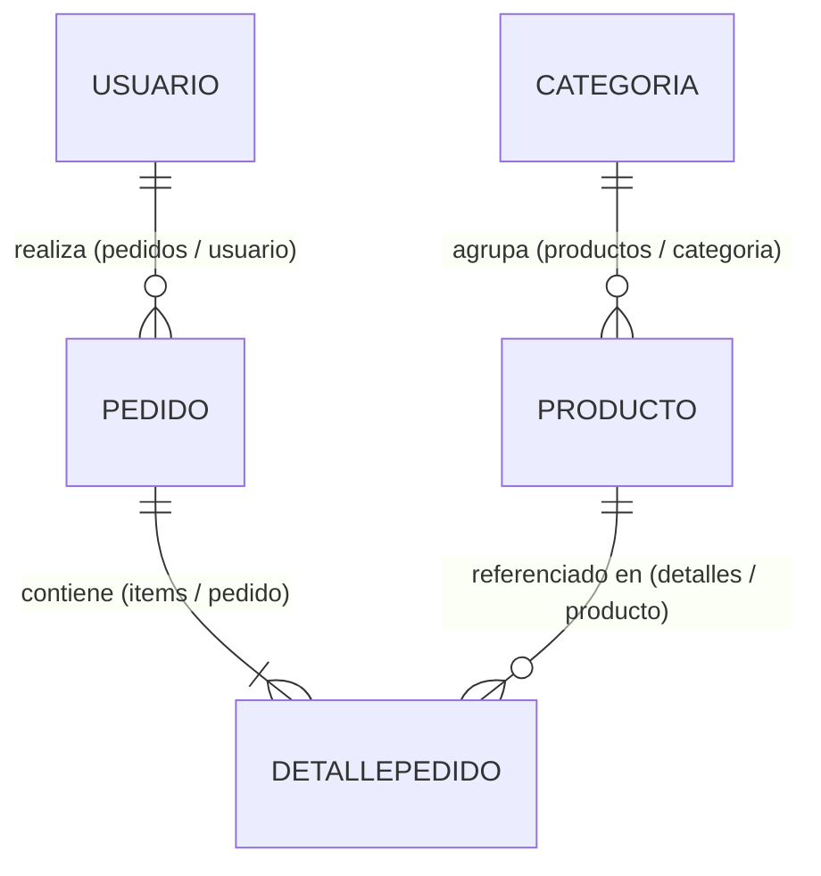

# ESQUEMA_BACKEND — Food Store

Modelo de datos, endpoints, schemas y repositorios, con los nombres exactos de la consigna. Todos los endpoints viven bajo `/api/v1`; documentación en `/docs` y `/redoc`.

## 1. Estructura de carpetas

```
backend/
├─ requirements.txt            versiones exactas
├─ .env.example                (y .env local, sin versionar)
└─ app/
   ├─ main.py                  FastAPI + CORS con credenciales + routers con prefijo /api/v1 + lifespan (create_all_tables)
   ├─ core/
   │  ├─ config.py             Settings (pydantic-settings)
   │  ├─ database.py           engine, create_all_tables, session_factory
   │  ├─ security.py           hash bcrypt, create_access_token, decode_access_token
   │  ├─ deps.py               get_current_user, get_current_active_user, require_role
   │  ├─ unit_of_work.py       UnitOfWork base (commit/rollback/close en __exit__)
   │  └─ base_repository.py    BaseRepository[T]: get_by_id, get_all, add, delete
   ├─ modules/
   │  ├─ __init__.py           importa todos los models (registro de mappers)
   │  ├─ auth/                 router, service, schemas        (usa Usuario)
   │  ├─ usuarios/             models, schemas, repository, unit_of_work, service, router
   │  ├─ categorias/           models, schemas, repository, unit_of_work, service, router
   │  ├─ productos/            models, schemas, repository, unit_of_work, service, router
   │  └─ pedidos/              models (Pedido, DetallePedido), schemas, repository, unit_of_work, service, router
   └─ db/
      └─ seed.py               admin + categorías + productos; idempotente
```

## 2. Modelo de datos (UML_FOOD_STORE)



Tipos: claves `int` autoincrementales, montos `float`, fechas `datetime`. Restricciones de rango en schemas y Service; **sin `CHECK`** en la base.

### Usuario
| Campo | Tipo | Reglas |
|---|---|---|
| `id` | int | PK |
| `username` | str | único, NN |
| `full_name` | str | NN |
| `email` | str | único, NN |
| `hashed_password` | str | NN; **nunca** se expone |
| `role` | str | NN, default `"user"`; `"user"` \| `"admin"` |
| `disabled` | bool | NN, default `false` (baja lógica) |
| `created_at` | datetime | NN (UTC) |

### Categoria
| Campo | Tipo | Reglas |
|---|---|---|
| `id` | int | PK |
| `nombre` | str | único, NN, 2 a 100 caracteres |
| `descripcion` | str | opcional |
| `activo` | bool | NN, default `true` (baja lógica) |

### Producto
| Campo | Tipo | Reglas |
|---|---|---|
| `id` | int | PK |
| `categoria_id` | int | FK → Categoria, NN |
| `nombre` | str | NN |
| `descripcion` | str | opcional |
| `precio_base` | float | NN, ≥ 0 |
| `imagen_url` | str | opcional |
| `stock` | int | NN, default 0, ≥ 0 |
| `disponible` | bool | NN, default `true` |
| `activo` | bool | NN, default `true` (baja lógica) |

Se vende solo si `activo`, `disponible` y `stock ≥ cantidad` (RN-01).

### Pedido
| Campo | Tipo | Reglas |
|---|---|---|
| `id` | int | PK |
| `usuario_id` | int | FK → Usuario, NN |
| `estado` | str | NN, default `"PENDIENTE"` |
| `forma_pago` | str | NN; `EFECTIVO` \| `TRANSFERENCIA` |
| `direccion_entrega` | str | NN, 5 a 200 caracteres |
| `notas` | str | opcional |
| `total` | float | NN; suma de subtotales; fijo |
| `created_at` | datetime | NN (UTC) |
| `updated_at` | datetime | NN (UTC); cambia en cada cambio de estado |

No se borra: se cancela.

### DetallePedido
| Campo | Tipo | Reglas |
|---|---|---|
| `id` | int | PK |
| `pedido_id` | int | FK → Pedido, NN |
| `producto_id` | int | FK → Producto, NN |
| `cantidad` | int | NN, ≥ 1 |
| `nombre_producto` | str | NN; copia del producto |
| `precio_unitario` | float | NN; copia del producto |
| `subtotal` | float | NN; `precio_unitario × cantidad` |

Línea inmutable (RN-05).

### Relationship (nombres exactos, con `back_populates`)

| Relación | Atributos |
|---|---|
| Categoria 1:N Producto | `Categoria.productos` ↔ `Producto.categoria` |
| Usuario 1:N Pedido | `Usuario.pedidos` ↔ `Pedido.usuario` |
| Pedido 1:N DetallePedido | `Pedido.items` ↔ `DetallePedido.pedido` |
| Producto 1:N DetallePedido | `Producto.detalles` ↔ `DetallePedido.producto` |

## 3. Endpoints

Acceso: **Público**, **Sesión** (`get_current_active_user`), **Dueño** (sesión + ser dueño), **admin** (`require_role(["admin"])`). Códigos comunes a todo endpoint con sesión: 401 (sin sesión válida), 400 "Cuenta de usuario desactivada"; con `admin`: 403; con cuerpo o parámetros: 422. Debajo, **solo los códigos propios**.

### Auth y usuarios

| Método | Endpoint | Descripción | Acceso | Respuesta | Errores propios |
|---|---|---|---|---|---|
| POST | `/auth/register` | Registra un usuario con rol `user` | Público | 201 `UserPublic` | 409 `username` o `email` ya existen |
| POST | `/auth/token` | Login con formulario OAuth2; setea la cookie | Público | 200 `{"message": "Login exitoso"}` | 401 credenciales incorrectas; 400 cuenta desactivada |
| POST | `/auth/logout` | Borra la cookie | Público | 200 | — |
| GET | `/auth/me` | Usuario autenticado | Sesión | 200 `UserPublic` | — |
| GET | `/admin/usuarios` | Listado de usuarios | admin | 200 `list[UserPublic]` | — |
| POST | `/admin/usuarios/{id}/activar` | `disabled = false` (idempotente) | admin | 200 `UserPublic` | 404 |
| POST | `/admin/usuarios/{id}/desactivar` | `disabled = true` (idempotente) | admin | 200 `UserPublic` | 404; 400 si se desactiva a sí mismo |

Orden del login: credenciales (401) → `disabled` (400).

### Categorías

| Método | Endpoint | Descripción | Acceso | Respuesta | Errores propios |
|---|---|---|---|---|---|
| GET | `/categorias` | Lista las activas | Público | 200 `list[CategoriaRead]` | — |
| GET | `/categorias/{id}` | Detalle | Público | 200 `CategoriaRead` | 404 |
| POST | `/categorias` | Crea; nombre único | admin | 201 `CategoriaRead` | 409 |
| PUT | `/categorias/{id}` | Actualiza (parcial) | admin | 200 `CategoriaRead` | 404, 409 |
| DELETE | `/categorias/{id}` | Baja lógica (`activo = false`) | admin | 204 sin cuerpo | 404 |

Una categoría dada de baja responde 404 en detalle, PUT y DELETE. Su nombre sigue ocupado (409 al reutilizarlo) y sus productos no se tocan.

### Productos

| Método | Endpoint | Descripción | Acceso | Respuesta | Errores propios |
|---|---|---|---|---|---|
| GET | `/productos` | Lista activos. Query: `skip`, `limit`, `search` (sobre `nombre`, sin distinguir mayúsculas), `categoria_id`, `disponible` | Público | 200 `ProductosPaginados` | — |
| GET | `/productos/{id}` | Detalle con su categoría | Público | 200 `ProductoRead` | 404 |
| POST | `/productos` | Crea con `categoria_id` | admin | 201 `ProductoRead` | 404 si la categoría no existe o está de baja |
| PUT | `/productos/{id}` | Actualiza los campos enviados | admin | 200 `ProductoRead` | 404 producto; 404 si la nueva categoría no existe o está de baja |
| PATCH | `/productos/{id}/stock` | Actualiza `stock` y `disponible` | admin | 200 `ProductoRead` | 404 |
| DELETE | `/productos/{id}` | Baja lógica (`activo = false`) | admin | 204 sin cuerpo | 404 |

Paginación: `skip` (default 0) y `limit` (default 20, máximo 100) → `{ "total": N, "items": [...] }`. `total` cuenta los que cumplen los filtros, no solo la página.

### Pedidos

| Método | Endpoint | Descripción | Acceso | Respuesta | Errores propios |
|---|---|---|---|---|---|
| POST | `/pedidos` | Crea el pedido desde el carrito (RN-01) | Sesión | 201 `PedidoRead` | 404 producto inexistente o inactivo; 400 stock insuficiente, no disponible o repetido |
| GET | `/pedidos` | Propios (`user`) o todos (`admin`). Query: `skip`, `limit`, `estado` | Sesión | 200 `PedidosPaginados` | — |
| GET | `/pedidos/resumen` | Indicadores del panel. **Declarar antes de `/{id}`** | admin | 200 `ResumenPedidos` | — |
| GET | `/pedidos/{id}` | Detalle con sus líneas | Dueño o admin | 200 `PedidoRead` | 404; 403 si es de otro usuario |
| PATCH | `/pedidos/{id}/estado` | Avanza o cancela según la máquina de estados (RN-02, RN-03) | admin | 200 `PedidoRead` | 404; 400 transición inválida |
| PATCH | `/pedidos/{id}/cancelar` | Cancela un pedido **propio** en `PENDIENTE` (RN-03, RN-04) | Dueño | 200 `PedidoRead` | 404; 403 pedido ajeno (también para admin); 400 si no está `PENDIENTE` |

Orden de chequeos en `cancelar`: 404 → 403 → 400.

## 4. Schemas (SQLModel sin `table=True`)

| Schema | Campos | Validaciones |
|---|---|---|
| `UserCreate` | `username`, `full_name`, `email`, `password` | `password` mín. 8 caracteres y máx. 72 **bytes** en UTF-8 (límite de bcrypt); `email` válido |
| `UserPublic` | `id`, `username`, `full_name`, `email`, `role`, `disabled`, `created_at` | nunca `hashed_password` |
| `CategoriaCreate` / `CategoriaUpdate` / `CategoriaRead` | `nombre`, `descripcion` (+ `id`, `activo` en Read) | `nombre` 2 a 100; Update: todos opcionales |
| `ProductoCreate` / `ProductoUpdate` / `ProductoRead` | `nombre`, `descripcion`, `precio_base`, `imagen_url`, `stock`, `disponible`, `categoria_id` (+ `id`, `activo`, `categoria: CategoriaRead` en Read) | `precio_base ≥ 0`, `stock ≥ 0`; Update: todos opcionales |
| `ProductoStockUpdate` | `stock`, `disponible` | `stock ≥ 0` (ambos opcionales, supuesto S2) |
| `ProductosPaginados` | `total: int`, `items: list[ProductoRead]` | — |
| `ItemPedidoCreate` | `producto_id`, `cantidad` | `cantidad ≥ 1` |
| `PedidoCreate` | `items: list[ItemPedidoCreate]`, `forma_pago`, `direccion_entrega`, `notas` | mín. 1 ítem; `forma_pago` ∈ {EFECTIVO, TRANSFERENCIA}; `direccion_entrega` 5 a 200 |
| `DetallePedidoRead` | `producto_id`, `nombre_producto`, `precio_unitario`, `cantidad`, `subtotal` | — |
| `PedidoRead` | `id`, `usuario_id`, `estado`, `forma_pago`, `direccion_entrega`, `notas`, `total`, `created_at`, `updated_at`, `items: list[DetallePedidoRead]` | — |
| `PedidosPaginados` | `total`, `items: list[PedidoRead]` | — |
| `CambioEstado` | `estado` | uno de los cuatro estados |
| `ResumenPedidos` | `pendientes`, `en_preparacion`, `entregados`, `cancelados`, `pedidos_hoy`, `ingresos_entregados` | conteos con `func.count`; `pedidos_hoy` desde la medianoche de Argentina (UTC-3, S1); ingresos = suma de `total` de los `ENTREGADO` (0 si no hay) |

Los schemas de lectura se arman con `Modelo.model_validate(objeto)` **dentro** del bloque del UoW. Nunca se devuelve un modelo de tabla.

## 5. Repositorios

| Repositorio | Consultas propias |
|---|---|
| `BaseRepository[T]` | `get_by_id`, `get_all`, `add`, `delete` |
| `UsuarioRepository` | `get_by_username`, `get_by_email` |
| `CategoriaRepository` | `get_by_nombre` |
| `ProductoRepository` | `search(nombre, categoria_id, disponible, skip, limit)` → (items, total), solo activos |
| `PedidoRepository` | `list_by_usuario`, `count_by_estado` (+ listado de todos para el admin, conteo de hoy e ingresos para el resumen) |

| Unit of Work | Repositorios expuestos (misma sesión) |
|---|---|
| `UsuarioUnitOfWork` | `usuarios` |
| `CategoriaUnitOfWork` | `categorias` |
| `ProductoUnitOfWork` | `productos`, `categorias` |
| `PedidoUnitOfWork` | `pedidos`, `productos` |

## 6. Excepciones de dominio (en cada `service.py`)

| Módulo | Excepciones |
|---|---|
| usuarios | `UsuarioNoEncontrado` (404), `UsuarioDuplicado` (409), autodesactivación (400) |
| categorias | `CategoriaNoEncontrada` (404), `NombreDuplicado` (409) |
| productos | `ProductoNoEncontrado` (404), `CategoriaNoEncontrada` (404, importada de categorias) |
| pedidos | `PedidoNoEncontrado` (404), `PedidoAjeno` (403), `ProductoNoEncontrado` (404), `StockInsuficiente` (400), `ProductoNoDisponible` (400), `ProductoRepetido` (400), `TransicionInvalida` (400) |

## 7. Seed (`python -m app.db.seed`)

Idempotente: crea las tablas, y solo inserta lo que falta.

- Usuario `admin` / `Admin1234!`, rol `admin` (email `admin@foodstore.com`, nombre completo "Administrador").
- Al menos 3 categorías (p. ej. Hamburguesas, Pizzas, Bebidas, Postres).
- 9 productos con stock, repartidos entre las categorías, cada uno con la foto que le corresponde (`imagen_url` apunta a una miniatura de 500 px de Wikimedia Commons; licencia y autor están anotados junto a cada URL en `db/seed.py`). Al volver a correr el seed, en los productos que ya existen solo se corrige `imagen_url` y, únicamente si todavía tiene la descripción anterior del seed (`DESCRIPCIONES_ANTERIORES`), la descripción: no se tocan stock, precio ni otros campos, no se pisan las ediciones del admin y no se duplican filas.
