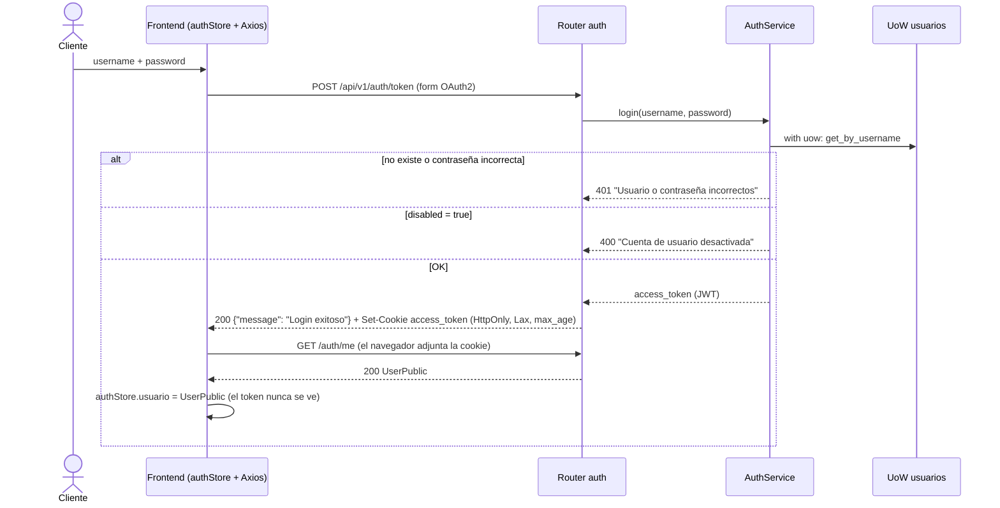
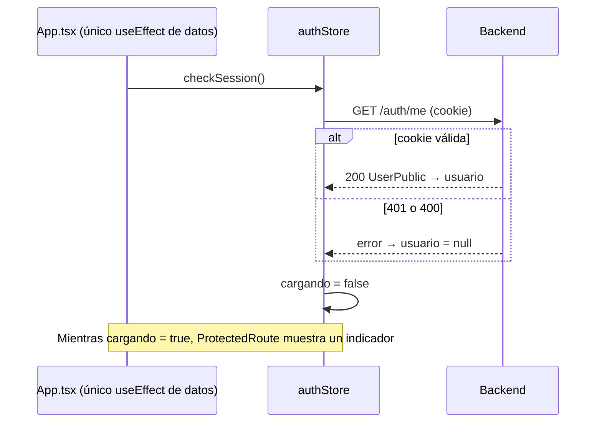
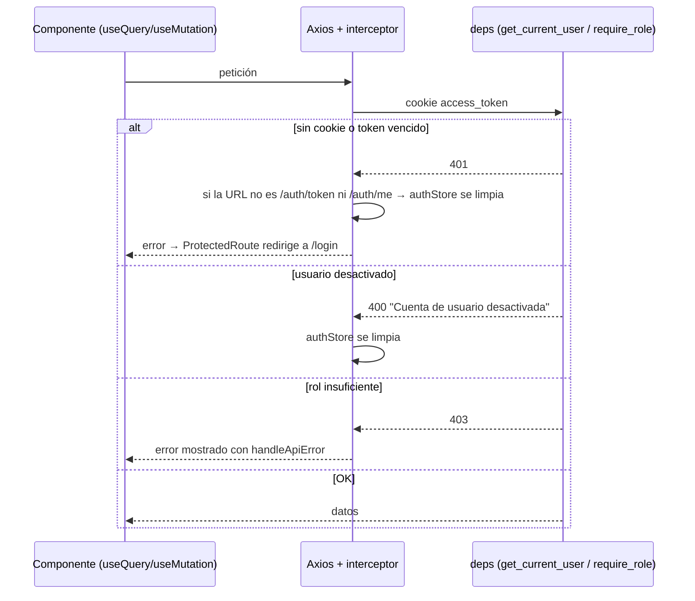
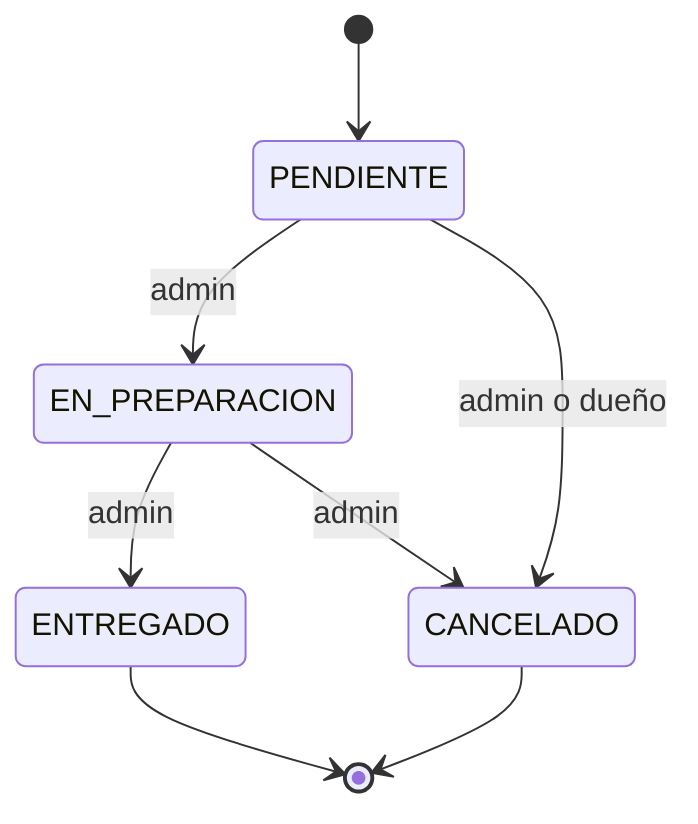

# FLUJO — Food Store

Diagramas de secuencia (Mermaid) de las interacciones que importan para la evaluación. Entidades y endpoints en [ESQUEMA_BACKEND.md](ESQUEMA_BACKEND.md); decisiones técnicas en [TRD.md](TRD.md).

## 1. Login con cookie HttpOnly



## 2. Recuperar la sesión al abrir la app



## 3. Petición protegida y 401 / 403



## 4. Crear pedido (RN-01) con Unit of Work

```mermaid
sequenceDiagram
    actor U as Cliente
    participant F as Checkout (TanStack Form + useMutation)
    participant R as Router pedidos
    participant S as PedidoService
    participant W as PedidoUnitOfWork
    participant DB as Base de datos
    U->>F: confirma (direccion_entrega, forma_pago, notas)
    F->>R: POST /pedidos {items, forma_pago, direccion_entrega, notas}
    R->>S: Depends(get_pedido_service) → crear(usuario, datos)
    S->>W: with self.uow as uow:
    S->>S: ¿producto_id repetido? → ProductoRepetido (400)
    S->>DB: INSERT pedido (PENDIENTE, total = 0)
    loop por cada ítem
        S->>DB: productos.get_by_id (precio y nombre salen de la base)
        S->>S: ¿existe y activo? sino ProductoNoEncontrado (404)
        S->>S: ¿disponible? sino ProductoNoDisponible (400)
        S->>S: ¿stock ≥ cantidad? sino StockInsuficiente (400)
        S->>DB: UPDATE producto.stock -= cantidad
        S->>DB: INSERT detalle (nombre_producto, precio_unitario, subtotal)
    end
    S->>DB: UPDATE pedido.total = Σ subtotales
    S->>S: PedidoRead.model_validate(pedido) (dentro del bloque)
    alt sin excepción
        W->>DB: __exit__ → COMMIT + close
        R-->>F: 201 PedidoRead
        F->>F: cartStore.vaciar(); invalida ['pedidos'] y ['productos']; navega a /mis-pedidos
    else cualquier excepción (p. ej. falla el 2.º ítem)
        W->>DB: __exit__ → ROLLBACK + close (el stock del 1.º ítem vuelve)
        R-->>F: 404 o 400 con detail
    end
```

## 5. Cancelar con restitución de stock (RN-03, RN-04)

```mermaid
sequenceDiagram
    actor U as Cliente (dueño)
    actor A as Admin
    participant R as Router pedidos
    participant S as PedidoService
    participant W as PedidoUnitOfWork
    U->>R: PATCH /pedidos/{id}/cancelar
    R->>S: cancelar(usuario, id)
    S->>W: with self.uow as uow:
    S->>S: 404 si no existe → 403 PedidoAjeno si no es suyo (aunque sea admin) → 400 si no está PENDIENTE
    loop por cada línea del pedido
        S->>W: productos.get_by_id (sin filtrar por activo) → stock += cantidad
    end
    S->>S: estado = CANCELADO; updated_at = ahora
    W-->>R: __exit__ → COMMIT
    R-->>U: 200 PedidoRead
    Note over A,R: El admin cancela pedidos ajenos con PATCH /pedidos/{id}/estado {"estado": "CANCELADO"} (misma restitución)
```

## 6. Admin cambia el estado (RN-02)

```mermaid
sequenceDiagram
    actor A as Admin
    participant R as Router pedidos
    participant S as PedidoService
    A->>R: PATCH /pedidos/{id}/estado {"estado": "..."}
    R->>S: cambiar_estado(id, estado)
    S->>S: 404 si no existe
    S->>S: ¿estado nuevo ∈ TRANSICIONES[estado actual]? sino TransicionInvalida (400)
    opt estado nuevo = CANCELADO
        S->>S: restituir stock de cada línea
    end
    S->>S: pedido.estado = nuevo; updated_at = ahora
    S-->>R: PedidoRead (COMMIT en __exit__)
    R-->>A: 200 PedidoRead
```

## 7. Máquina de estados



## 8. Activar / desactivar usuario

```mermaid
sequenceDiagram
    actor A as Admin
    participant R as Router usuarios
    participant S as UsuarioService
    A->>R: POST /admin/usuarios/{id}/desactivar
    R->>S: desactivar(admin, id)
    S->>S: 404 si no existe
    S->>S: 400 si id == admin.id (no puede desactivarse a sí mismo)
    S->>S: disabled = true (idempotente: si ya lo estaba, igual 200)
    S-->>R: UserPublic (COMMIT en __exit__)
    R-->>A: 200 UserPublic
    Note over A,R: El usuario desactivado recibe 400 en su próxima petición; el interceptor limpia su sesión
```

## 9. Logout

```mermaid
sequenceDiagram
    participant N as Navbar
    participant St as authStore
    participant R as Backend
    N->>St: logout()
    St->>R: POST /auth/logout
    R-->>St: 200 + borra la cookie (mismos atributos)
    St->>St: usuario = null; se descartan las consultas propias (pedidos y usuarios) de TanStack Query
    N->>N: navigate("/login")
```
